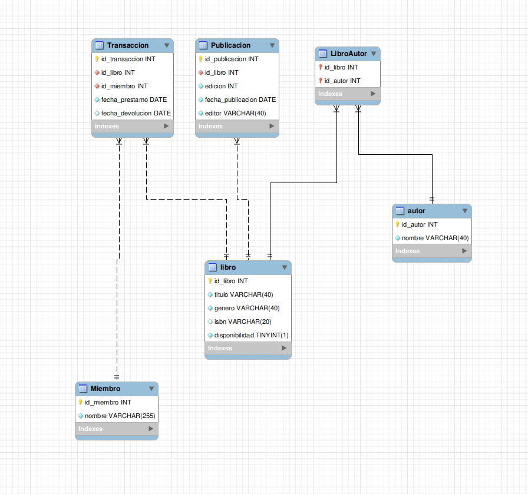
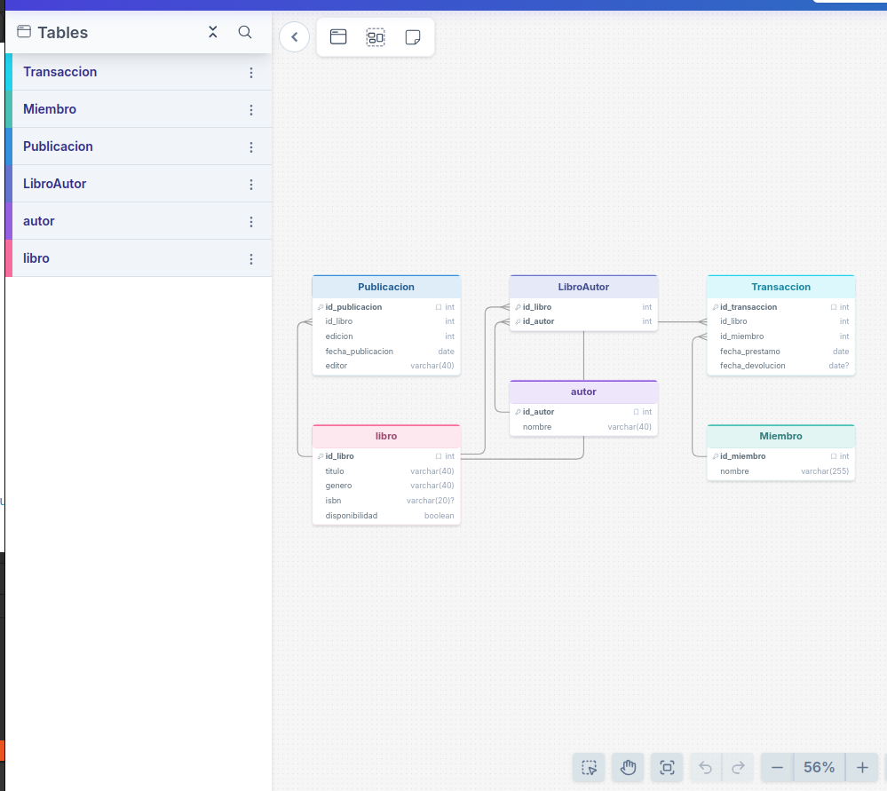

# Biblioteca Campus · MySQL

Base de datos relacional en MySQL para una biblioteca: libros, autores, ediciones, miembros y préstamos, con 20 consultas SQL de ejemplo.


> Examen final de la habilidad de bases de datos MySQL (Campuslands).

## Qué resuelve

Registra el catálogo de la biblioteca (libros con sus autores y ediciones), los miembros y el historial de préstamos y devoluciones, y permite consultar disponibilidad, historial y última edición de cada libro.

## Modelo de datos

Seis tablas en la base `biblioteca_campus`:

| Tabla | Descripción |
| --- | --- |
| `libro` | Título, género, ISBN y disponibilidad |
| `autor` | Autores |
| `LibroAutor` | Relación muchos a muchos entre libros y autores (PK compuesta) |
| `Publicacion` | Ediciones de un libro: número de edición, fecha y editor |
| `Miembro` | Miembros de la biblioteca |
| `Transaccion` | Préstamos y devoluciones (`fecha_devolucion` nula = préstamo vigente) |

### Diagramas

Entidad-relación:



Modelo físico:



Modelo lógico: [`diagramaLogic.png`](diagrams/diagrama_logico.png/diagramaLogic.png) y [`diagrama_logic.png`](diagrams/diagrama_logico.png/diagrama_logic.png).

## Consultas incluidas

`mysql/db.sql` trae, además del esquema, 20 consultas comentadas: libros disponibles, búsqueda por género o ISBN, conteos, libros por autor (`JOIN` con `LibroAutor`), ediciones y última edición de un libro (subconsulta con `MAX`), préstamos vigentes, historial por miembro y por libro, y un listado de libros con su última edición y disponibilidad.

## Estructura

```text
├── mysql/
│   ├── db.sql       # CREATE DATABASE, tablas y las 20 consultas
│   └── insert.sql   # datos de ejemplo
└── diagrams/        # ER, modelo lógico y físico
```

## Requisitos

MySQL 8 (o compatible) y un cliente: consola `mysql`, MySQL Workbench o similar.

## Instalación y ejecución

```bash
git clone https://github.com/TOTO05-a/biblioteca-campus-mysql.git
cd biblioteca-campus-mysql
mysql -u <usuario> -p < mysql/db.sql
mysql -u <usuario> -p < mysql/insert.sql
```

`db.sql` crea la base y las tablas y luego ejecuta las consultas; `insert.sql` carga los datos de ejemplo (si quieres ver resultados en las consultas, cárgalo antes de ejecutar la sección de consultas, o corre las consultas por separado).

## Variables de entorno

No aplica: es un proyecto de scripts SQL, no hay `.env`.

## Autor

**Eduardo Antonio Cruz Bolaños** — [@TOTO05-a](https://github.com/TOTO05-a)
